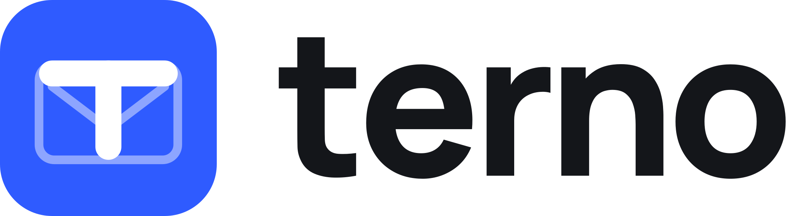

<h1 align="center">
  <picture>
    <source media="(prefers-color-scheme: dark)" srcset="brand/terno-lockup-white.svg" />
    
  </picture>
</h1>

<p align="center"><strong>Your mail, made to measure.</strong></p>

<p align="center">
  A minimalist, keyboard-first and extremely fast email client for macOS, with a web version that runs the same backend in your browser.
</p>

<p align="center">
  <a href="https://github.com/luisiacc/terno/releases">Download</a> ·
  <a href="docs/FEATURES.md">Features</a> ·
  <a href="docs/DEVELOPMENT.md">Development</a> ·
  <a href="CONTRIBUTING.md">Contributing</a>
</p>

---

## Highlights

- **Fast.** Search answers each keystroke in under a millisecond across 50,000+ messages, and every budget is [enforced by a test](docs/PERFORMANCE.md).
- **Private.** Your mail is stored only on your Mac. Terno has no server of its own that keeps it.
- **Every account in one place.** Gmail and any IMAP/SMTP server, with categories that span accounts.
- **Smart, without AI.** Terno learns how you file and sorts new mail on its own when it's sure, always with undo.
- **Optional AI, your choice of provider.** Ask your mail questions, draft replies in your voice, summarize conversations and build filters from a sentence, on a local model or with your own key. [More →](docs/AI.md)
- **Calm, native design.** Five styles and 20 color themes, light and dark, all checked for contrast. Replies are written inline, and drafts are never lost.
- **Built for agents.** An MCP server gives Claude Code and Codex one access point to all your email. [More →](docs/MCP.md)

## Getting started

Download the latest build from [Releases](https://github.com/luisiacc/terno/releases), or run it from source (Node 24+, pnpm 12):

```bash
pnpm install
pnpm dev:desktop:demo   # Electron with a demo mailbox
pnpm dev:web            # the web build at http://127.0.0.1:5175
```

[Development](docs/DEVELOPMENT.md) covers every command, the test suites and connecting Gmail.

## Documentation

| | |
|---|---|
| [Features](docs/FEATURES.md) | Everything Terno does today |
| [AI](docs/AI.md) | Providers, summaries, drafting, Ask your mail, follow-ups and spending limits |
| [Terno on the web](docs/WEB.md) | How the browser version works and what needs the Mac app |
| [Agents (MCP)](docs/MCP.md) | Connecting Claude Code and Codex |
| [Architecture](docs/ARCHITECTURE.md) | How it fits together, and the repository layout |
| [Performance](docs/PERFORMANCE.md) | The measured budgets every release must hold |
| [Development](docs/DEVELOPMENT.md) | Setup, tests, translations and styles |
| [Diagnostics](docs/DIAGNOSTICS.md) | Logs, crash records and opt-in error reports |
| [Upgrading from Única](docs/UPGRADING-FROM-UNICA.md) | What carries over from Terno's former name |
| [Plans](docs/plans/) | The design record behind every feature |

## Contributing

Contributions are welcome. Read [CONTRIBUTING.md](CONTRIBUTING.md) before you start, and [AGENTS.md](AGENTS.md) for the principles every change upholds. Bugs and ideas go in [issues](https://github.com/luisiacc/terno/issues).

## License

Terno is **source-available** under the [Business Source License 1.1](LICENSE), and each version becomes open source under the GNU AGPL-3.0 three years after its release.

It's free for personal use and for organizations with fewer than 100 people and less than US$5 million in annual revenue. Larger organizations need a Pro or Business seat for each person who uses it for work. See [LICENSING.md](LICENSING.md) for the details, and [TRADEMARKS.md](TRADEMARKS.md) for the use of the name.

Made by Luisiacc LLC.
